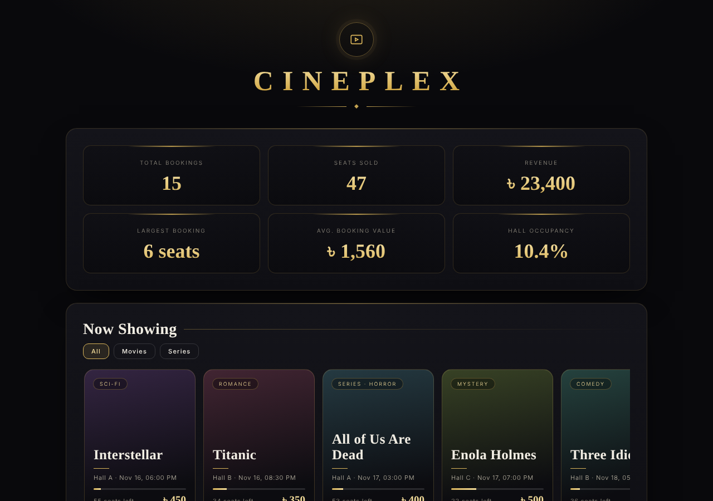
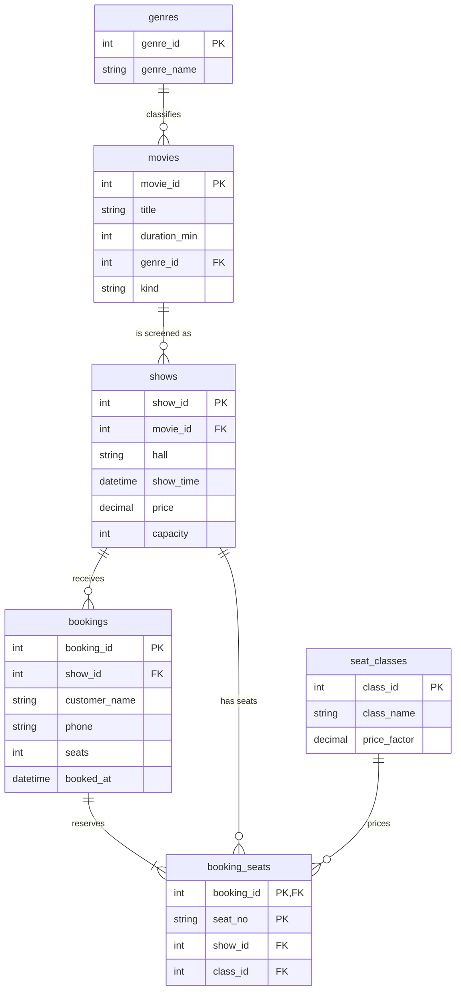

<h1 align="center">CINEPLEX</h1>
<p align="center"><i>Premium Cinema Booking · Database Management System Lab Project</i></p>

A single-page cinema booking application. It stores, searches, updates and deletes records in a **real SQL database** (SQLite running in the browser, so nothing needs to be installed).

**Live demo:** `https://<your-username>.github.io/<repo-name>/` (enable *Settings → Pages → main branch*)



## Features (mapped to the lab requirements)
| Requirement | Cineplex |
|---|---|
| Add records | New Booking form + interactive seat map (Premium / Standard) |
| View records | Bookings table, "Now Showing" cards |
| Search / filter | Search by name or phone (`LIKE`), filter by show (`WHERE`), Movies / Series tabs |
| Update records | Edit button loads the booking into the form, then `UPDATE` |
| Delete records | Delete button with confirmation dialog |
| Summary (aggregates) | `COUNT`, `SUM`, `MAX`, `AVG` cards + revenue-by-title chart (`GROUP BY`) |
| Single page | Everything on one page, no navigation |
| Extras | Printable ticket, CSV export, live "Last SQL query executed" panel |

## Database design
6 tables, primary keys everywhere, foreign keys between related tables, 15 sample bookings.



## Files
```
cineplex/
├── index.html            the complete app in ONE file (open this; works offline, even without extracting)
├── database.sql          CREATE + INSERT script (SQLite, used by the app)
├── database_mysql.sql    same schema and data for MySQL 8
├── queries.sql           key INSERT / SELECT / UPDATE / DELETE / aggregate queries
├── screenshots/          screenshots of the working app
├── source/               readable source code
│   ├── index.html        page layout (HTML)
│   ├── css/style.css     design (dark + gold theme)
│   ├── js/app.js         application code: every SQL query is here (commented)
│   ├── js/schema.js      database.sql packed for the browser
│   └── js/lib/           SQLite engine for the browser (sql.js, WebAssembly), third-party
└── tools/build.js        rebuilds index.html from source/ (node tools/build.js)
```

## Run
Double-click `index.html` (works offline), or open the GitHub Pages link. After editing anything in `source/` or `database.sql`, run `node tools/build.js` to rebuild `index.html`. To use MySQL: `mysql -u root -p < database_mysql.sql`.

## Tools
HTML5, CSS3, JavaScript, SQL, SQLite (sql.js / WebAssembly), MySQL 8, Git & GitHub.
